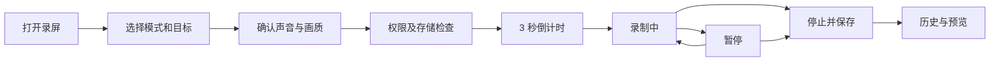

# 屏幕录制模块设计提案

日期：2026-10-30。状态：模块正式定名为「屏幕录制」，核心录制流程已实现；本文件保留产品目标，当前行为与后续范围见 [使用说明](screen-recording.md)。

## 定位与入口

为 Jarvis 增加独立的「屏幕录制」技能，侧边栏放在「截图」下方，首页提供对应技能入口。主要用于软件演示、操作教程和问题复现。沿用现有主题、强调色、工具栏和历史宫格组件。

提供主界面、菜单栏、可配置全局快捷键三个入口。默认键位统一为 F1 截图、F2 屏幕录制、F3 剪贴板、F4 会议录制。F2 空闲时打开准备面板，再按开始，录制中按下停止；仍可配置独立停止键。修改键位前检查冲突，窗口布局快捷键不变。

## 页面信息结构

主页面顶部工具栏放时间筛选、搜索、宫格大小和「新建录制」。正文显示录制历史，空状态展示三种模式及「开始第一次录制」。配置放在新建录制面板中，避免配置区长期挤占历史空间。

准备面板从上到下为：

1. 模式选择：全屏 / 窗口 / 自定义区域。
2. 录制目标预览、名称与「重新选择」。目标无效时禁用开始按钮并解释原因。
3. 系统声音、麦克风开关；麦克风开启后显示设备选择和音量电平。
4. 画质与帧率，更多设置内提供编码、鼠标、倒计时和保存位置。
5. 「开始录制」主按钮，旁边显示最终输出尺寸与声音状态摘要。

启动时记住画质与保存位置；复用声音偏好时仍明确显示状态。上次的窗口和屏幕仅在重新验证有效后复用，不自动退回到全屏。

## 三种录制模式

| 模式 | 选择方式 | 录制行为 |
| --- | --- | --- |
| 全屏 | 显示器缩略图、名称、分辨率；也可在屏幕上点选 | 一次选择一个显示器。录制该显示器上的可见内容，切换应用仍继续 |
| 窗口 | 窗口缩略图列表，支持按应用名称和窗口标题搜索；提供桌面点选 | 绑定具体窗口，跟随移动；被其他窗口遮挡时仍采集目标窗口内容 |
| 自定义区域 | 跨屏显示遮罩，在某一显示器内拖拽选区 | 支持移动、八方向缩放、输入宽高、自由比例或 16:9；录制开始后范围固定 |

选区阶段显示像素尺寸，Enter 确认、Esc 取消。首版限定区域位于单个显示器内，拖动越界时约束到该屏，避免混合缩放比例。选区边框在录制中保持轻量提示，并从成片中排除。

窗口录制固定输出画布大小。窗口尺寸改变时等比适配并留边，避免视频尺寸改变或内容拉伸。窗口最小化时自动暂停并提示；恢复后由用户继续。窗口关闭则结束录制、保存已有内容。窗口跨显示器与跨空间的实际行为需通过真机验证，异常时暂停或结束并给出原因，不静默切换采集目标。

## 完整录制流程

权限只在需要时请求；未开麦克风时不请求麦克风权限。屏幕权限未授权时解释用途，并提供授权或前往系统设置入口。权限返回后重新检测，并保留用户的准备配置；确需重启才能生效时明确提示。

倒计时默认为 3 秒，可选关闭或 5 秒。倒计时允许 Esc 取消，不产生空历史。开始前隐藏 Jarvis 主窗口；录制中显示悬浮控制条和菜单栏状态。收到首个有效视频帧且写入启动后才进入正式录制计时。

悬浮控制条包含录制标识、有效录制时长、暂停/继续、停止和折叠。支持拖动；尽可能放在区域外，并通过采集过滤排除 Jarvis 的控制界面。系统自带录屏指示由 macOS 管理。暂停时显示明确文字，不仅改变颜色；暂停期间不写入有效内容，恢复后的时间轴连续、音画同步。

关闭主窗口不结束录制。退出应用时提供「停止并保存后退出」和「取消退出」。正常停止不额外确认；进入「正在保存」状态，最终文件完成封装后才显示保存成功和可播放记录。

## 建议默认值

| 设置 | 默认 | 可选范围 |
| --- | --- | --- |
| 格式与编码 | MP4 / H.264 / SDR | 可增加 HEVC 节省空间，按设备能力提供 |
| 分辨率 | 保持比例、不放大，限制在 1920×1080 包围框内 | 原始像素尺寸、1080p 上限、720p 上限 |
| 帧率 | 30fps | 60fps，用于动态演示 |
| 系统声音 | 开启，准备面板明确显示 | 开 / 关 |
| 麦克风 | 关闭 | 开 / 关，开启时选择设备 |
| 鼠标指针 | 显示 | 显示 / 隐藏 |
| 倒计时 | 3 秒 | 关闭 / 3 秒 / 5 秒 |
| 保存位置 | 用户「影片/Jarvis」目录 | 用户选择目录 |

默认全屏/区域模式录制系统输出；窗口模式首版也明确标注「系统声音」，不承诺只录该窗口的声音。未来可增加「目标应用声音」，但需说明同一应用多个窗口的声音可能无法逐窗区分。

麦克风与系统声音混合成可直接播放的音轨；蓝牙设备变化、采样率差异与暂停恢复需专项验证。耳机/麦克风断开时明确提示，保留屏幕录制；未经用户选择不自动开启另一支麦克风。

## 录制历史与保存

历史宫格沿用截图模块的视觉规范，视频缩略图保持比例、必要时留边；卡片显示标题、时长、时间与录制模式。支持今天/近三天/近七天/全部筛选，以及标题搜索。

双击打开预览，支持播放、暂停、拖动进度、全屏、重命名、在 Finder 显示、复制文件和系统分享。首版提供单条删除并确认，不自动清理用户的视频。文件名使用「录屏_日期_时间.mp4」，内部用 UUID 标识记录，避免重名和标题修改影响关联。

元数据记录 ID、标题、时间、模式、时长、像素尺寸、帧率、文件大小、声音配置、视频位置和缩略图。文件被移走时显示「文件不存在」，可重新定位或移除记录。删除记录与删除视频的影响需在确认文案中明确，首版删除动作同步删除视频和索引。

长录制采用可恢复的临时分段方案，正常停止后合并输出单个 MP4。异常退出后下次启动扫描未完成会话，恢复已经成功封装的分段；当前未完成分段可能丢失，不承诺零损失。保存失败保留可恢复数据并允许重试或另存，不先清理临时文件。

## 异常与并行规则

- 开始前检查写入权限和磁盘余量，录制中持续监测；接近预留阈值时主动收尾并提示，阈值结合码率和合并需要确定。
- 显示器断开、屏幕锁定、系统休眠、屏幕权限撤销：结束本次录制并尽力保存，解锁后不自动恢复录制。
- 采集停止、持续异常黑帧或写入失败：退出「录制中」状态并显示原因。受保护内容可能不可采集，不能把真实黑色画面直接判定为故障。
- 同时仅允许一个屏幕录制会话。录制期间可切换 Jarvis 模块。
- 首版与会议录音互斥；启动另一种录制时提示先停止现有会话，不自动终止。当前菜单栏已有会议录音状态，需要统一呈现两种会话。
- 正式版和开发版的权限、记录和临时目录继续隔离。

## 技术落点（实现前验证）

项目当前最低系统为 macOS 26，使用 SwiftUI + AppKit。建议 ScreenCaptureKit 负责屏幕/窗口/音频采集，自定义区域使用显示器内容加 sourceRect；AVAssetWriter 负责需要暂停、音画时间戳控制及分段恢复的写入。SCRecordingOutput 可作为直接录制路径的备选，但需要先验证是否满足上述行为，避免两套写入路径长期并存。

建议拆分职责：

- ScreenRecordingModels：模式、配置、会话状态、历史模型。
- ScreenRecordingService：采集会话、音视频样本与目标变化。
- ScreenRecordingWriter：编码、混音、时间轴、分段与合并。
- ScreenRecordingSelectionController：屏幕/窗口选择与区域遮罩。
- ScreenRecordingPanelController：悬浮条与倒计时。
- ScreenRecordingRepository：文件、元数据、缩略图与恢复索引。
- ScreenRecordingView 与 AppModel+ScreenRecording：主页面及应用协调。

复用项目的权限工具、主题和历史组件，参考 ScreenshotCoordinateSpace 的 Retina 换算。截图选区目前面向静态画面，会议录音面向音频，复用其经验和公共组件前需核查边界，不直接把原有控制器当录屏控制器。

状态至少包含 idle、selecting、ready、countdown、starting、recording、paused、stopping、saving、failed。停止与保存期间禁用重复启动；同一会话的回调使用会话 ID 校验，防止旧任务覆盖新状态。

Apple 参考资料：

- [ScreenCaptureKit](https://developer.apple.com/documentation/screencapturekit)
- [Capture HDR content with ScreenCaptureKit：麦克风采集和文件录制能力](https://developer.apple.com/videos/play/wwdc2024/10088/)
- [sourceRect：显示器裁剪区域，不适用于单窗口采集](https://developer.apple.com/documentation/screencapturekit/scstreamconfiguration/sourcerect?language=objc)

## 首版范围与验收

首版包含三种录制模式、系统声音与麦克风、30/60fps、暂停继续、倒计时、菜单栏与悬浮控制条、自动保存和历史预览。后续再增加摄像头画中画、鼠标点击高亮、快捷键可视化、简单裁剪和字幕，避免首版扩展成视频编辑器。

关键验收：

1. 三种模式产出可播放的 MP4，实际内容与预览范围一致，控制界面不出现在成片中。
2. Retina、不同缩放比例、负坐标外接屏和竖屏的坐标、比例与像素尺寸正确。
3. 窗口移动、遮挡、缩放、最小化和关闭符合约定；跨屏/跨空间行为经过真机验证。
4. 四种声音组合均验证，包含麦克风权限拒绝和设备断开。
5. 多次暂停恢复后画面连续、无暂停空段、音画同步；时长不包含暂停时间。
6. 30 分钟持续录制观察内存、CPU、文件增长和音画同步；60fps、原始分辨率单独测量负载，不提前承诺性能数值。
7. 权限拒绝、磁盘不足、写入失败、锁屏、拔屏和异常退出不会产生虚假的成功记录，已完成分段可恢复。
8. 全局快捷键无应用内冲突；会议录音互斥规则明确；主窗口关闭后仍可停止录屏。
